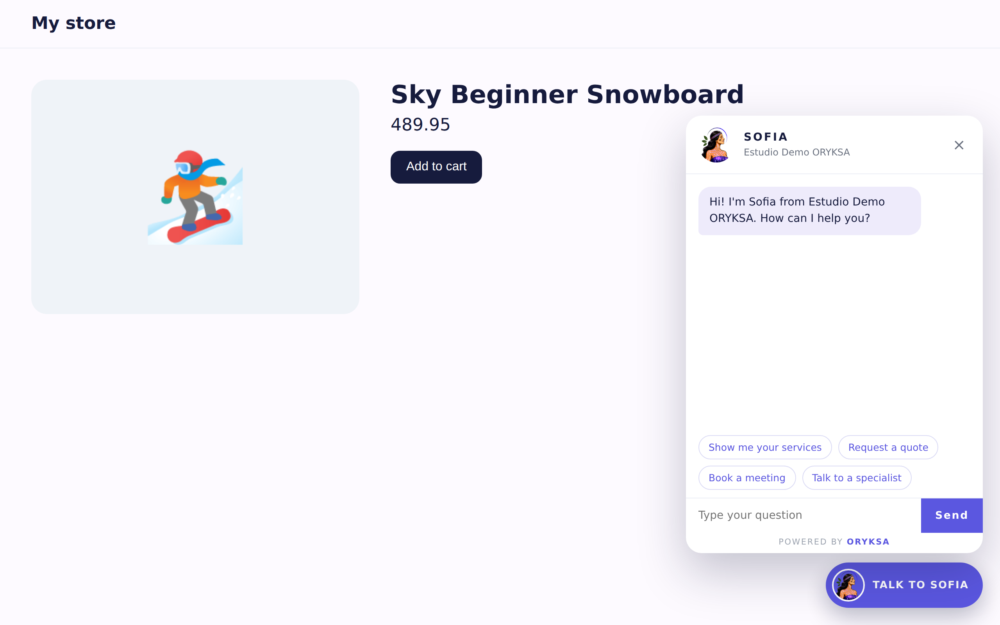
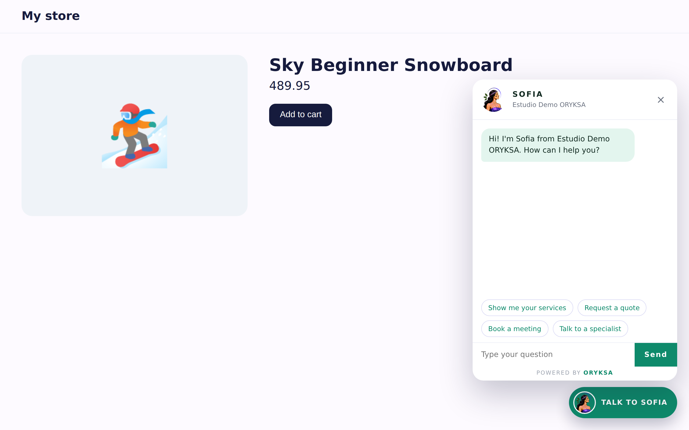

<p align="center"></p>

# @oryksa/sdk

[](README.md) [](README.pt.md) [](README.es.md) [](README.fr.md)

<p align="center"><a href="https://developer.oryksa.com/es/sdks"></a></p>

SDK oficial de JavaScript y TypeScript de **ORYKSA AI Employees**: pon un empleado de IA que ya conoce el negocio dentro de tu app web, tu backend Node o tu app de escritorio Electron. El mismo cerebro de WhatsApp y del chat del sitio web, en texto y voz.

- Documentación: https://developer.oryksa.com
- API: `https://api.oryksa.com/v1`

## Capturas de pantalla

<p align="center"> </p>

Una página de tienda con `mountChat`, capturada por el CI en Chrome con una cuenta de prueba de ORYKSA (`test/shots.html`): colores por defecto a la izquierda y, a la derecha, el código de *Colores y tema*, más abajo.

## Instalar

```bash
npm install @oryksa/sdk
```

## Servidor (clave secreta)

```js
import { Oryksa } from "@oryksa/sdk";
const oryksa = new Oryksa(process.env.ORYKSA_API_KEY); // developer.oryksa.com > Keys

const r = await oryksa.chat({ message: "Are you open on Saturday?" });
console.log(r.reply, r.conversation_id);

// Teach the AI employee about your app (e.g. on every release)
await oryksa.learnApp({
  name: "FitTrack",
  description: "Fitness app to log workouts and follow training plans.",
  screens: [{ title: "Workouts", content: "Tap + to log a workout." }],
  faq: [{ question: "How do I cancel Premium?", answer: "Settings > Subscription > Cancel." }],
});
```

## En la app (token de sesión, nunca la clave secreta)

```js
// your server
app.get("/oryksa-token", requireLogin, async (req, res) => {
  const s = await oryksa.createSession({ conversationId: "user-" + req.user.id, customerName: req.user.firstName });
  res.json({ token: s.client_token });
});

// your web app
import { OryksaClient, mountChat } from "@oryksa/sdk";
const client = new OryksaClient({ getToken: async () => (await fetch("/oryksa-token").then(r => r.json())).token });
mountChat({ client, lang: "en" }); // ready-made chat UI
```

## Enlaces con botón Abrir (0.1.5)

Los enlaces que da la IA se pueden pulsar en el chat (direcciones web y e-mails), y cada enlace web tiene una tarjeta debajo de su respuesta con la foto y el título de la página y un botón **Abrir** (las páginas de tu propio sitio, los dominios de tu chat web; otros sitios muestran la dirección). Pasa `onLink` para abrir tus propias páginas, por ejemplo la página del producto: devuelve true cuando tu app lo abrió, false para abrirlo en una pestaña nueva.

```js
mountChat({
  client, lang: "es",
  onLink: (url) => {
    const id = myProductIdOf(url); // tus rutas
    if (!id) return false;
    router.push("/product/" + id);
    return true;
  },
});
```

`client.linkPreview(url)` da el título y la foto de un enlace (`null` cuando no se puede leer); `linksIn(text)` y `withoutLinks(text)` también se exportan.

## Adjuntar una foto o un documento (0.1.5)

El chat de `mountChat` tiene un botón para adjuntar: foto de la galería, cámara (móviles y tabletas) o documento (PDF, Word, texto, CSV). Las fotos se reducen antes de enviarse (hasta 2 MB); documentos hasta 8 MB. La IA ve la foto o lee el documento. Se desactiva con `attachments: false`. Por código: `client.send(texto, { image: { base64, mime } })` o `{ file: { base64, name, mime } }`.

## Tus funciones de IA: `ai` (0.1.5)

Haz que la IA haga lo que tu app o web necesita (leer una foto, extraer datos, clasificar, traducir, escribir) y paga con interacciones ORYKSA: 1 por respuesta. Tu prompt y tu JSON Schema viven en tu código; basta el token de sesión (nunca lleves la clave secreta). No crea una conversación en tu bandeja.

```js
const r = await client.ai({
  instructions: "Read the tyre on the photo: brand, model and size exactly as written on the sidewall. " +
    "If the size is not legible, readable=false and size=null. Never invent.",
  images: [{ base64: photoBase64, mime: "image/jpeg" }], // resized to 1600 px
  schema: {
    type: "object",
    properties: { readable: { type: "boolean" }, brand: { type: ["string", "null"] }, size: { type: ["string", "null"] } },
    required: ["readable", "brand", "size"],
  },
});
if (r.json?.readable) showProducts(r.json.size);
```

`r.text` trae la respuesta en texto, `r.json` el objeto (con schema) y `r.interactionsSpent` las interacciones usadas. Cuando se agotan las interacciones del plan, la llamada falla con `OryksaError` status 402.

## Colores y tema

`mountChat` acepta tres colores como texto CSS: `accent` (botones, burbujas del visitante, enlaces), `ink` (texto principal) y `soft` (burbujas de la IA). Los que falten mantienen el valor por defecto (`#5B57E0`, `#161B3D` y `#EEEBFB`). `position` (`"left"` o `"right"`) elige el lado de la pantalla.

```js
mountChat({ client, lang: "en", accent: "#0E8A6B", ink: "#10281F", soft: "#E3F5EE" });
```

## Webhooks

```js
import { verifyWebhook } from "@oryksa/sdk";
app.post("/oryksa-webhook", express.raw({ type: "application/json" }), async (req, res) => {
  const event = await verifyWebhook(req.body, req.get("ORYKSA-Signature"), process.env.ORYKSA_WEBHOOK_SECRET);
  if (event.type === "booking.created") { /* save it */ }
  res.sendStatus(200);
});
```

## Errores

Cada llamada que falla lanza `OryksaError` con `status`, `code` (por ejemplo `interaction_limit_reached`, `rate_limited`, `plan_required`) y `message`.

## Sobre el autor

**Weslley Harakawa** - Fundador de ORYKSA AI. En Lisboa, Portugal. Especialidades: inteligencia artificial, desarrollo web y móvil, tokenización en blockchain. Formación: University of the People.

- LinkedIn: https://www.linkedin.com/in/weslleyharakawa/
- ORYKSA AI Employees: https://oryksa.com (X: https://x.com/oryksa, Instagram: https://www.instagram.com/oryksaai, YouTube: https://www.youtube.com/@ORYKSA)

---

MIT License · ORYKSA AI Employees · W8 Atlantic Unipessoal Lda
