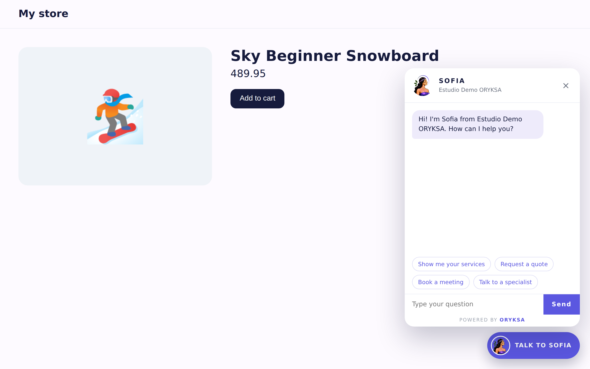
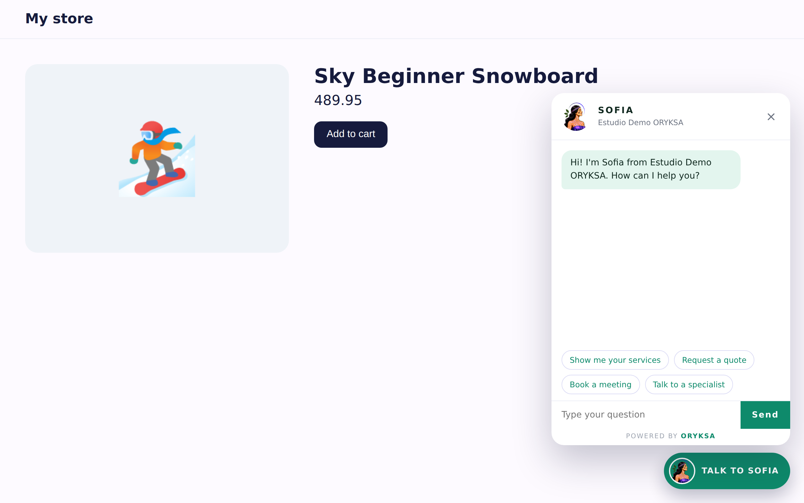

<p align="center"></p>

# @oryksa/sdk

[](README.md) [](README.pt.md) [](README.es.md) [](README.fr.md)

<p align="center"><a href="https://developer.oryksa.com/fr/sdks"></a></p>

SDK officiel JavaScript et TypeScript d'**ORYKSA AI Employees** : placez un employé IA qui connaît déjà l'entreprise dans votre app web, votre backend Node ou votre app de bureau Electron. Le même cerveau que WhatsApp et le chat du site web, en texte et en voix.

- Documentation : https://developer.oryksa.com
- API : `https://api.oryksa.com/v1`

## Captures d'écran

<p align="center"> </p>

Une page de boutique avec `mountChat`, capturée par la CI dans Chrome avec un compte de test ORYKSA (`test/shots.html`) : couleurs par défaut à gauche et, à droite, le code de *Couleurs et thème*, plus bas.

## Installer

```bash
npm install @oryksa/sdk
```

## Serveur (clé secrète)

```js
import { Oryksa } from "@oryksa/sdk";
const oryksa = new Oryksa(process.env.ORYKSA_API_KEY); // developer.oryksa.com > Keys

const r = await oryksa.chat({ message: "Are you open on Saturday?" });
console.log(r.reply, r.conversation_id);

// Teach the AI employee about your app (e.g. on every release)
await oryksa.learnApp({
  name: "FitTrack",
  description: "Fitness app to log workouts and follow training plans.",
  screens: [{ title: "Workouts", content: "Tap + to log a workout." }],
  faq: [{ question: "How do I cancel Premium?", answer: "Settings > Subscription > Cancel." }],
});
```

## Dans l'app (jeton de session, jamais la clé secrète)

```js
// your server
app.get("/oryksa-token", requireLogin, async (req, res) => {
  const s = await oryksa.createSession({ conversationId: "user-" + req.user.id, customerName: req.user.firstName });
  res.json({ token: s.client_token });
});

// your web app
import { OryksaClient, mountChat } from "@oryksa/sdk";
const client = new OryksaClient({ getToken: async () => (await fetch("/oryksa-token").then(r => r.json())).token });
mountChat({ client, lang: "en" }); // ready-made chat UI
```

## Couleurs et thème

`mountChat` accepte trois couleurs en texte CSS : `accent` (boutons, bulles du visiteur, liens), `ink` (texte principal) et `soft` (bulles de l'IA). Celles qui manquent gardent la valeur par défaut (`#5B57E0`, `#161B3D` et `#EEEBFB`). `position` (`"left"` ou `"right"`) choisit le côté de l'écran.

```js
mountChat({ client, lang: "en", accent: "#0E8A6B", ink: "#10281F", soft: "#E3F5EE" });
```

## Webhooks

```js
import { verifyWebhook } from "@oryksa/sdk";
app.post("/oryksa-webhook", express.raw({ type: "application/json" }), async (req, res) => {
  const event = await verifyWebhook(req.body, req.get("ORYKSA-Signature"), process.env.ORYKSA_WEBHOOK_SECRET);
  if (event.type === "booking.created") { /* save it */ }
  res.sendStatus(200);
});
```

## Erreurs

Chaque appel qui échoue lève `OryksaError` avec `status`, `code` (par exemple `interaction_limit_reached`, `rate_limited`, `plan_required`) et `message`.

## À propos de l'auteur

**Weslley Harakawa** - Fondateur d'ORYKSA AI. À Lisbonne, Portugal. Spécialités : intelligence artificielle, développement web et mobile, tokenisation blockchain. Formation : University of the People.

- LinkedIn: https://www.linkedin.com/in/weslleyharakawa/
- ORYKSA AI Employees: https://oryksa.com (X: https://x.com/oryksa, Instagram: https://www.instagram.com/oryksaai, YouTube: https://www.youtube.com/@ORYKSA)

---

MIT License · ORYKSA AI Employees · W8 Atlantic Unipessoal Lda
