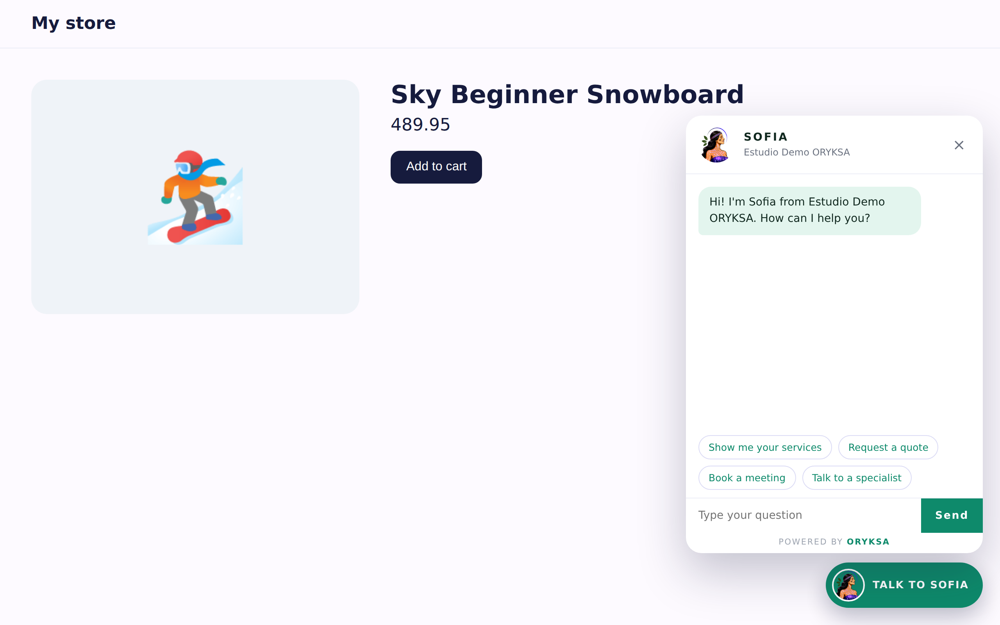

<p align="center"></p>

# @oryksa/sdk

[](README.md) [](README.pt.md) [](README.es.md) [](README.fr.md)

<p align="center"><a href="https://developer.oryksa.com/en/sdks"></a></p>

Official JavaScript and TypeScript SDK for **ORYKSA AI Employees**: put an AI employee that already knows the business inside your web app, Node backend or Electron desktop app. Same brain as WhatsApp and the website chat, text and voice.

- Docs: https://developer.oryksa.com
- API: `https://api.oryksa.com/v1`

## Screenshots

<p align="center"> </p>

A store page with `mountChat`, captured by CI in Chrome with an ORYKSA test account (`test/shots.html`): default colors on the left, the code of *Colours and theme* below on the right.

## Install

```bash
npm install @oryksa/sdk
```

## Server (secret key)

```js
import { Oryksa } from "@oryksa/sdk";
const oryksa = new Oryksa(process.env.ORYKSA_API_KEY); // developer.oryksa.com > Keys

const r = await oryksa.chat({ message: "Are you open on Saturday?" });
console.log(r.reply, r.conversation_id);

// Teach the AI employee about your app (e.g. on every release)
await oryksa.learnApp({
  name: "FitTrack",
  description: "Fitness app to log workouts and follow training plans.",
  screens: [{ title: "Workouts", content: "Tap + to log a workout." }],
  faq: [{ question: "How do I cancel Premium?", answer: "Settings > Subscription > Cancel." }],
});
```

## In the app (session token, never the secret key)

```js
// your server
app.get("/oryksa-token", requireLogin, async (req, res) => {
  const s = await oryksa.createSession({ conversationId: "user-" + req.user.id, customerName: req.user.firstName });
  res.json({ token: s.client_token });
});

// your web app
import { OryksaClient, mountChat } from "@oryksa/sdk";
const client = new OryksaClient({ getToken: async () => (await fetch("/oryksa-token").then(r => r.json())).token });
mountChat({ client, lang: "en" }); // ready-made chat UI
```

## Colours and theme

`mountChat` accepts three colors as CSS strings: `accent` (buttons, visitor bubbles, links), `ink` (main text) and `soft` (AI bubbles). Missing ones keep the default (`#5B57E0`, `#161B3D` and `#EEEBFB`). `position` (`"left"` or `"right"`) picks the side of the screen.

```js
mountChat({ client, lang: "en", accent: "#0E8A6B", ink: "#10281F", soft: "#E3F5EE" });
```

## Webhooks

```js
import { verifyWebhook } from "@oryksa/sdk";
app.post("/oryksa-webhook", express.raw({ type: "application/json" }), async (req, res) => {
  const event = await verifyWebhook(req.body, req.get("ORYKSA-Signature"), process.env.ORYKSA_WEBHOOK_SECRET);
  if (event.type === "booking.created") { /* save it */ }
  res.sendStatus(200);
});
```

## Errors

Every failed call throws `OryksaError` with `status`, `code` (for example `interaction_limit_reached`, `rate_limited`, `plan_required`) and `message`.

## About the author

**Weslley Harakawa** - Founder of ORYKSA AI. Based in Lisbon, Portugal. Specialties: artificial intelligence, web and mobile development, blockchain tokenization. Education: University of the People.

- LinkedIn: https://www.linkedin.com/in/weslleyharakawa/
- ORYKSA AI Employees: https://oryksa.com (X: https://x.com/oryksa, Instagram: https://www.instagram.com/oryksaai, YouTube: https://www.youtube.com/@ORYKSA)

---

MIT License · ORYKSA AI Employees · W8 Atlantic Unipessoal Lda
